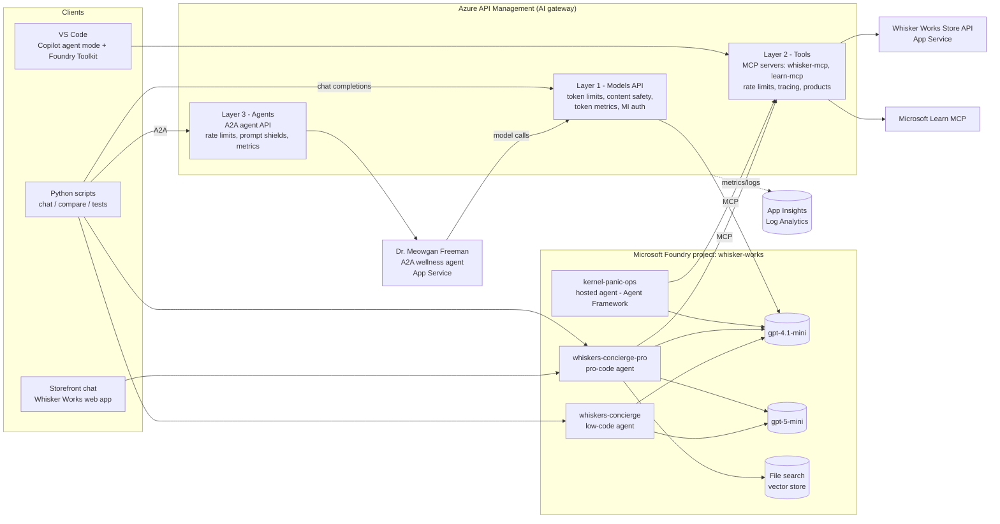

# 🐾 Whisker Works — Foundry Agents + APIM AI Gateway demo kit

A complete, end-to-end demo environment themed around **Whisker Works**, a retail store owned and run by
funny techie cats (Sir Purrcival Byte, Null Pointer, Kernel Panic and Miss Kittens-Debug).

Explore **Microsoft Foundry Agent Service** (low-code portal agents, pro-code prompt agents, and
**hosted agents** built with Microsoft Agent Framework) and **Azure API Management as an AI gateway** governing the
three layers of agentic AI: **models, tools (MCP) and agents (A2A)**. Tooling: **VS Code** (Foundry Toolkit,
GitHub Copilot) and **GitHub Desktop** (+ GitHub Actions).

**Start with the [self-paced Jupyter walkthrough](docs/whisker-works-demo-runbook.ipynb) or the
[walkthrough overview](docs/demo-run-of-show.md).** Work through the topics in order, or choose the
capabilities you want to explore and complete their prerequisites. The notebook combines portal steps,
sample prompts, and approval-gated command cells; the topic guides provide the equivalent detailed instructions.
No prepared environment is assumed: choose a setup mode below before making Azure calls.

The notebook is the source of truth for topic order. Guide filenames, page titles, and navigation
follow that order. Setup guides use `00` / `00b`; the cat-food specialist is an unnumbered optional extension.

<a id="what-you-can-demo"></a>

## Choose what to explore

| # | Activity | Guide |
|---|------|-------|
| 0 | Build the environment (one script) | [docs/00-setup-environment.md](docs/00-setup-environment.md) |
| 0b | *Alternate:* reuse an **existing** Foundry + APIM | [docs/00b-setup-existing-environment.md](docs/00b-setup-existing-environment.md) |
| 1 | Refresher: building blocks of an agent | [docs/01-agent-building-blocks.md](docs/01-agent-building-blocks.md) |
| 2 | Create an agent in the Foundry portal (low-code: knowledge + tools) | [docs/02-build-prompt-agent-foundry-portal.md](docs/02-build-prompt-agent-foundry-portal.md) |
| 3 | Create the Store MCP server, test it, and connect the low-code agent | [docs/03-connect-store-tools-mcp.md](docs/03-connect-store-tools-mcp.md) |
| 4 | Create the pro-code agent from VS Code with Foundry Toolkit + GitHub Copilot | [Pro-code guide](docs/04-create-prompt-agent-code.md) |
| 5 | Hosted agent with Microsoft Agent Framework (code tools + approval + APIM MCP) | [Hosted-agent guide](docs/05-build-hosted-agent-framework.md) |
| 6 (optional) | Container Apps external agent: Foundry observability versus APIM enforcement | [Container Apps guide](docs/06-optional-container-apps-agent.md) |
| 7 | Tour agent details (versions, traces, monitoring, evaluations) | [Agent details guide](docs/07-versions-traces-evaluations.md) |
| 8 | Update an agent to a new model (portal, code, GitHub Desktop + Actions) | [Model update guide](docs/08-change-model-safely.md) |
| 9 | APIM AI gateway — Layer 1: **Models** governance | [Model gateway guide](docs/09-govern-model-calls.md) |
| 10 | Demonstrate **Azure AI Content Safety** through APIM | [Content Safety guide](docs/10-content-safety-gateway.md) |
| 11 | APIM — Layer 2: MCP governance, Learn MCP, and optional order-tool approval | [MCP governance guide](docs/11-govern-mcp-tools.md) |
| 12 | APIM — Layer 3: **Agents**. Govern an A2A agent | [A2A guide](docs/12-govern-agent-to-agent-calls.md) |
| 13 | Storefront and next steps | [Storefront verification](docs/demo-run-of-show.md#storefront-and-next-steps) |
| Extension (optional) | Purrfessor Nibbles: hosted MAF cat-food specialist with concierge delegation | [Cat-food specialist guide](docs/optional-cat-food-specialist.md) |
| — | Self-paced overview, prerequisites, and troubleshooting | [Walkthrough overview](docs/demo-run-of-show.md) |
| — | Frequently asked questions | [docs/faq.md](docs/faq.md) |
| — | Interactive self-paced Jupyter walkthrough | [docs/whisker-works-demo-runbook.ipynb](docs/whisker-works-demo-runbook.ipynb) |
| — | Documentation references | [docs/references.md](docs/references.md) |

## Architecture



<a id="demo-cast-and-assets"></a>

## Sample agents and assets

| Asset | What it is | Used in |
|-------|------------|---------|
| `whiskers-concierge` | Low-code prompt agent built in the Foundry portal (file search + code interpreter + MCP) | 2, 3, 7, 8 |
| `whiskers-concierge-pro` | Pro-code prompt agent from [agents/procode/agent.yaml](agents/procode/agent.yaml); also powers the storefront chat | 4, 8, 11, 13 |
| `whiskers-orders-approval` | Optional isolated agent for the Gold-only order MCP server and human approval | 11 |
| `kernel-panic-ops` | Hosted agent (Microsoft Agent Framework): Python tools, approval-gated purchase orders, APIM MCP | 5 |
| `purrfessor-nibbles` (optional) | Hosted MAF cat-food specialist; opt-in Foundry A2A delegation from the concierge | Extension |
| `kernel-panic-aca` (optional) | Standalone Container Apps agent, external Foundry trace registration (preview), APIM inbound and MCP controls | 6 |
| Dr. Meowgan Freeman | A2A wellness agent on App Service, governed by APIM | 12 |
| Whisker Works Store API + storefront | FastAPI app (products `WW-001`…, orders `ORD-1001`…) exposed via APIM and as an MCP server | 3, 4, 9, 11, 13 |
| APIM products | **Whisker Bronze** (500 TPM) / **Whisker Gold** (20K TPM), subscriptions `whisker-demo-bronze` / `whisker-demo-gold` | 3, 9-12 |
| Sample data | Knowledge files, sales CSV, evaluation JSONL in [data/](data/) | 2, 4, 5, 7, 8 |

## Prerequisites (summary)

Azure subscription with Owner (or Contributor + User Access Administrator), model quota for **gpt-4.1-mini** and
**gpt-5-mini**, Azure CLI, Python 3.11+, VS Code (+ recommended extensions), and for the hosted agent
path the Azure Developer CLI (`azd` + `azure.ai.agents` extension). Docker is needed only for the
container-build route, not Foundry remote code deployment. GitHub Desktop is optional if you use Git
directly; a GitHub repository and Actions configuration are needed only to run the optional CI/CD workflow. Full list:
[docs/00 §1](docs/00-setup-environment.md#1-prerequisites) or [docs/00b §1-2](docs/00b-setup-existing-environment.md#1-check-compatibility).

## Two ways to set up

| Mode | When | What's deployed | Guide |
|------|------|-----------------|-------|
| **New** (default) | Clean subscription / own sandbox | Foundry account + project + 2 models, APIM Basic v2, App Service (2 apps), App Insights — [infra/main.bicep](infra/main.bicep) | [docs/00](docs/00-setup-environment.md) |
| **Existing** | Foundry and APIM already exist (e.g. shared platform) | Only App Service + App Insights in a demo RG; `whisker-*` APIs/backends/products added to your APIM; optional model deployments + RBAC on your Foundry — [infra/existing.bicep](infra/existing.bicep) | [docs/00b](docs/00b-setup-existing-environment.md) |

Both modes use the same [scripts/deploy.sh](scripts/deploy.sh) and produce the same `agents/procode/.env`, so every
demo guide works unchanged (path differences are listed in docs/00b §6).

Optional resource-group tags `CostControl=Ignore` and `SecurityControl=ignore` are enabled by default and copied by Bicep
onto all tag-capable demo resources in that group. Set `ENABLE_CONTROL_TAGS=false` to skip adding them. This does not remove
tags already present or establish an inheritance policy for future resources; existing Foundry/APIM resources in reused environments
are unchanged. Use these exemption tags only with your organization's approval.

## Repository map

```
infra/main.bicep                 Mode "new": all Azure resources (Foundry, models, APIM Basic v2, App Service, App Insights, RBAC)
infra/existing.bicep             Mode "existing": reuse Foundry + APIM
infra/modules/                   apim-demo-config.bicep (APIM additions), foundry-demo-access.bicep (deployments + RBAC)
apim/policies/                   One policy per governance layer (models / MCP tools / A2A agents) + optional backend pool snippet
src/catstore-api/                Whisker Works store API + storefront (FastAPI). OpenAPI spec -> imported into APIM -> MCP
src/a2a-agent/                   "Dr. Meowgan Freeman" A2A agent (JSON-RPC + agent card), calls models through APIM
agents/lowcode/                  Copy/paste values for the portal-built agent
agents/procode/                  agent.yaml (source of truth) + create/chat/compare scripts
agents/hosted/                   "Kernel Panic" hosted agent (Microsoft Agent Framework, azd ai agent)
agents/container-app/            Optional read-only external Kernel Panic runtime (Container Apps, Topic 6)
data/knowledge/                  Knowledge files for file search (policies, product guide, cat care)
data/sales/                      Sales CSV for code interpreter
data/eval/                       Evaluation dataset (JSONL)
scripts/                         Deployment, tests and cleanup (see table below)
tests/whisker.http               REST Client requests
.vscode/mcp.json                 APIM-hosted MCP servers for GitHub Copilot agent mode
.vscode/extensions.json          Recommended VS Code extensions
.github/workflows/               Agent version CI/CD (used in the "new model" demo)
.github/copilot-instructions.md  Repo conventions for GitHub Copilot
policies/                        Pre-existing standalone APIM policy samples (not used by the demo kit)
```

## Scripts

| Script | Purpose |
|--------|---------|
| [scripts/deploy.sh](scripts/deploy.sh) | Deploys infra (new or existing mode), zip-deploys both web apps, writes `agents/procode/.env` |
| [scripts/create-mcp-servers.sh](scripts/create-mcp-servers.sh) | Backup for topics 3 and 11: creates Store and Learn MCP servers. Use `READ_ONLY=true` to keep `placeOrder` out of the shared read-only server |
| [scripts/test-gateway.py](scripts/test-gateway.py) | Layer 1 demos: `basic`, `throttle` (Bronze 429), `safety` (Prompt Shields 403) |
| [scripts/test-a2a.py](scripts/test-a2a.py) | Layer 3 demo: agent card + `message/send` through APIM (or `--direct`) |
| [agents/procode/create_agent.py](agents/procode/create_agent.py) | Creates a new version of `whiskers-concierge-pro` from `agent.yaml` (`--model` override) |
| [agents/procode/chat.py](agents/procode/chat.py) | Interactive chat with any agent/version; shows tools used and tokens |
| [agents/procode/compare_models.py](agents/procode/compare_models.py) | Compares two agent versions on the eval set (pass rate, latency, tokens) |
| [scripts/cleanup.sh](scripts/cleanup.sh) | Deletes the demo resource group and purges the Foundry account it created |
| [scripts/cleanup-apim-config.sh](scripts/cleanup-apim-config.sh) | Existing mode: removes only the `whisker-*` items from a shared APIM |

## Configuration (`agents/procode/.env`)

Written by `deploy.sh` (template: [agents/procode/.env.sample](agents/procode/.env.sample)); git-ignored because it holds APIM keys.

| Variable | Used by |
|----------|---------|
| `FOUNDRY_PROJECT_ENDPOINT` | All agent scripts |
| `APIM_GATEWAY_URL`, `APIM_MODELS_PATH`, `APIM_STORE_PATH`, `APIM_MCP_PATH` | Gateway tests, agent MCP tool, REST calls |
| `APIM_GOLD_KEY`, `APIM_BRONZE_KEY`, `APIM_SUBSCRIPTION_KEY` | Tests; MCP key fallback when no project connection |
| `MCP_PROJECT_CONNECTION_NAME` | Preferred: Foundry connection holding the APIM key ([topic 3](docs/03-connect-store-tools-mcp.md#part-c--prepare-connection-reuse-for-pro-code)) |
| `CHAT_MODEL`, `NEW_MODEL` | Model deployment names |
| `RG`, `APIM_NAME`, `APIM_RG` | MCP creation and cleanup scripts |

The hosted agent has its own settings in the azd environment (see [docs/05](docs/05-build-hosted-agent-framework.md)) and
[agents/hosted/.env.sample](agents/hosted/.env.sample) for local runs.

## Before publishing or sharing

- Publish source through Git, **not an archive of this working directory**. Local environment files,
  Azure/Foundry state, build bundles, logs, evaluation results, and private-key files are excluded by
  [.gitignore](.gitignore); those files can still exist on your machine.
- Keep credentials in local environment files or Foundry project connections. Share only the blank
  [pro-code](agents/procode/.env.sample), [hosted](agents/hosted/.env.sample), and
  [cat-food specialist](agents/cat-food/.env.sample) templates. Never paste keys into source,
  notebook cells, screenshots, issue reports, or command output.
- Clear **all notebook outputs and execution counts** before committing. Keep the runbook's embedded
  teaching diagrams; they are Markdown attachments, not execution outputs. Reset every live-action
  `approval` field to `""` so each person must review and approve their own Azure calls.
- After initializing your repository, inspect `git status --short --untracked-files=all` and
  `git diff --cached` before the first push. Ignore rules do not protect files already tracked.
  Scan the staged files **and the full Git history** with a secret scanner before making it public.
  If a credential was ever shared or committed, revoke/rotate it and remove it from history;
  deleting the current copy alone is not sufficient.
- Run the offline documentation/publication checks:
  `python3 -m unittest discover -s tests -p test_docs.py`.
  These verify local documentation links, topic order, ignore rules, and clean notebook outputs;
  they do not replace a full secret scan. Review external URLs separately.
- Choose and add an appropriate license before inviting reuse; public visibility alone does not grant
  others permission to reuse the code.

## Quick start

After cloning the code and installing the prerequisites, deploy a new environment:

```bash
az login
PUBLISHER_EMAIL=you@contoso.com LOCATION=southeastasia ./scripts/deploy.sh
```

Then follow [docs/00-setup-environment.md](docs/00-setup-environment.md) from step 4.

Already have Foundry and APIM? Use existing mode instead — see [docs/00b-setup-existing-environment.md](docs/00b-setup-existing-environment.md):

```bash
FOUNDRY_ACCOUNT=<name> FOUNDRY_RG=<rg> FOUNDRY_PROJECT=<project> APIM_NAME=<name> APIM_RG=<rg> LOCATION=southeastasia ./scripts/deploy.sh
```

The new-environment default is **APIM Basic v2**, approximately **US$150/month**, plus **US$13/month** for the shared Linux B1 plan
(Southeast Asia public rates checked on 4 October 2026, 730 hours/month). Budget **US$163/month fixed**, plus model tokens,
monitoring, tools and optional hosted-agent resources. Existing-resource mode keeps the current APIM tier.
See [setup cost guidance](docs/00-setup-environment.md#cost-and-tier-choice) and [APIM pricing](https://azure.microsoft.com/pricing/details/api-management/).

Clean up when you're done: APIM Basic v2 and the App Service B1 plan incur charges even when unused; Global Standard model inference is usage-based.

```bash
RG=rg-whisker-works ./scripts/cleanup.sh       # new mode: everything
./scripts/cleanup-apim-config.sh               # existing mode: whisker-* items in your APIM (then cleanup.sh for the demo RG)
```

> Preview features: some capabilities used here (MCP server management API `2025-09-01-preview`, A2A in APIM,
> Foundry Toolkit, certain Foundry agent tools) are in preview and the portal UI evolves quickly. Labels in the guides
> may differ slightly; the doc links in [docs/references.md](docs/references.md) are the source of truth.
