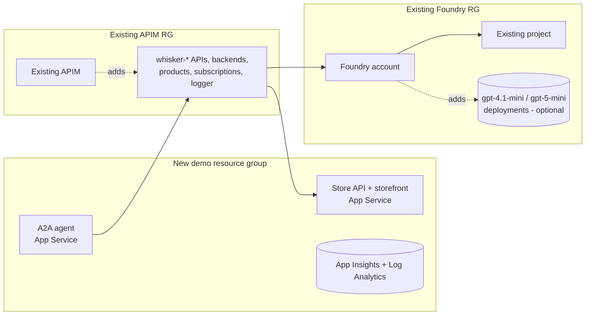

# 00b — Alternate setup: Foundry and API Management already exist

Use this guide instead of [00-setup-environment.md](00-setup-environment.md) when you already have a
**Microsoft Foundry** account/project and an **API Management** instance (for example, a shared platform team instance).
The demo adds only what it needs, with `whisker-` prefixed names, and deploys the demo apps in a separate resource group.
New demo web apps and monitoring resources default to Southeast Asia (`southeastasia`); your existing Foundry and APIM resources remain in their current regions.
The **optional** tags `CostControl=Ignore` and `SecurityControl=ignore` are enabled by default on the demo resource group.
The Bicep template copies that group's tags onto the new tag-capable demo resources. Existing Foundry and APIM resources and their
resource groups are not tagged by this script. Child resources that do not support tags are excluded; this is template-based propagation,
not automatic inheritance for future resources. Only enable these exemption tags when your organization's governance permits them.



## 1. Check compatibility

| Requirement | Why | How to check |
|---|---|---|
| Foundry account kind **AIServices** with a **Foundry project** (not a hub-based project) | Agents API, project endpoint `https://<sub>.services.ai.azure.com/api/projects/<project>` | Foundry portal (new experience) shows the project; `az cognitiveservices account show --query kind` |
| Models available: **gpt-4.1-mini** and **gpt-5-mini** (or equivalents) | Agents + "new model" demo | Foundry > Models + endpoints. If names differ, see step 4 |
| APIM tier **Developer, Basic, Standard, Premium (classic) or Basic v2 / Standard v2 / Premium v2** | MCP servers, A2A APIs and `llm-*` policies aren't available in Consumption | `az apim show --query sku.name` |
| APIM **not** using workspaces for this demo | MCP servers aren't supported in workspaces | Deploy into the service, not a workspace |
| APIM **system-assigned managed identity** | Keyless calls to Foundry + Content Safety | Portal > APIM > Managed identities (the script enables it if off) |
| Network: APIM can reach the Foundry endpoint and `*.azurewebsites.net`; Foundry Agent Service can reach the APIM gateway | Model calls, Store API, MCP from agents | If Foundry has public access disabled or APIM is internal-VNet, you need private networking — out of scope for this kit |
| Global APIM diagnostics don't log **response bodies** (or log 0 bytes) | Body logging breaks MCP streaming | APIM > APIs > All APIs > Settings > Diagnostics logs |
| API paths `models` and `store` free (or pick others) | Avoid clashing with existing APIs | APIM > APIs |

## 2. Permissions you need

| Scope | Role | For |
|---|---|---|
| Demo resource group (new) | Contributor | App Service, App Insights |
| APIM instance | **API Management Service Contributor** | APIs, backends, products, subscriptions, logger, enabling MI |
| Foundry account | **Owner** or **User Access Administrator** + Contributor | Role assignments for APIM / storefront / you; model deployments |
| Foundry project | Foundry Project Manager (granted by the template) | Hosted agents (docs/05), connections |

> No Owner on the shared Foundry account? Ask the owner to grant, on the account: *Cognitive Services OpenAI User* and
> *Cognitive Services User* to the APIM managed identity, *Azure AI User* to the storefront web app identity and to you,
> and *Foundry Project Manager* on the project to you. Then remove the `foundryAccess` module from [infra/existing.bicep](../infra/existing.bicep).

## 3. What gets created or changed

| Where | Created / changed | Names |
|---|---|---|
| New demo RG | Log Analytics, App Insights, App Service plan (B1), 2 web apps | `whisker-*-<suffix>` |
| Existing APIM | Logger, 2 backends, 2 APIs, 2 products, 3 subscriptions, API-scoped diagnostics | `whisker-appinsights-logger`, `whisker-foundry-models`, `whisker-content-safety`, `whisker-works-api`, `whisker-bronze`, `whisker-gold`, `whisker-demo-*`, `whisker-a2a-agent-internal` |
| Existing APIM (only if `GLOBAL_APIM_DIAGNOSTICS=true`) | **Overwrites** the All-APIs `applicationinsights` diagnostic | — avoid on shared instances |
| Existing Foundry account | Model deployments (optional), role assignments | `gpt-4.1-mini`, `gpt-5-mini` |
| Existing Foundry project | Agents, vector store, connections created during the demos | `whiskers-*`, `kernel-panic-ops`, `whisker-knowledge` |

## 4. Deploy

1. Clone the repository and open it in VS Code — see [setup step 2](00-setup-environment.md#2-get-the-code).
2. Sign in and set up Python:
   ```bash
   az login && az account set --subscription "<subscription of the demo RG>"
   python3 -m venv .venv && source .venv/bin/activate
   pip install -r agents/procode/requirements.txt
   ```
3. Run the deploy script in **existing mode** (it's triggered by `FOUNDRY_ACCOUNT` + `APIM_NAME`):
   ```bash
   FOUNDRY_ACCOUNT=<foundry-account-name> FOUNDRY_RG=<foundry-rg> FOUNDRY_PROJECT=<project-name> \
   APIM_NAME=<apim-name> APIM_RG=<apim-rg> \
   RG=rg-whisker-works \
   ./scripts/deploy.sh
   ```
   Optional variables:

   | Variable | Default | Use when |
   |---|---|---|
   | `CREATE_MODEL_DEPLOYMENTS` | `true` | Set `false` to reuse existing deployments |
   | `CONNECT_FOUNDRY_APP_INSIGHTS` | `true` | Set `false` when the shared Foundry project already has an Application Insights connection that must be preserved |
  | `ENABLE_CONTROL_TAGS` | `true` | Set `false` to skip adding the optional control tags. Existing group tags are still copied; this does not remove tags already present. |
   | `CHAT_MODEL` / `NEW_MODEL` | `gpt-4.1-mini` / `gpt-5-mini` | Your **deployment names** differ (with `CREATE_MODEL_DEPLOYMENTS=false`) |
   | `MODELS_API_PATH` / `STORE_API_PATH` | `models` / `store` | Paths already used in your APIM |
   | `GLOBAL_APIM_DIAGNOSTICS` | `false` | Dedicated APIM you're happy to reconfigure globally |
    | `LOCATION` | `southeastasia` | Change the region for the new demo web apps and monitoring resources. Existing Foundry and APIM stay in their current regions. |

   The script runs pre-flight checks (Foundry kind, project exists, APIM tier, managed identity), deploys
   [infra/existing.bicep](../infra/existing.bicep) (modules [apim-demo-config.bicep](../infra/modules/apim-demo-config.bicep)
   and [foundry-demo-access.bicep](../infra/modules/foundry-demo-access.bicep)), zip-deploys both web apps and writes
   `agents/procode/.env` (including `APIM_RG`, `APIM_MODELS_PATH`).

4. If you used custom deployment names, update `model:` in [agents/procode/agent.yaml](../agents/procode/agent.yaml)
   and the model choices in the low-code steps (docs/02, docs/08).

## 5. Verify

```bash
set -a; source agents/procode/.env; set +a
curl -s "$APIM_GATEWAY_URL/$APIM_STORE_PATH/products?category=beds" -H "Ocp-Apim-Subscription-Key: $APIM_GOLD_KEY" | head -c 300; echo
python scripts/test-gateway.py basic
```
Role assignments can take a few minutes to propagate (`401` from the models API at first is normal).

## 6. Continue with the normal flow

Resume at [00 step 5](00-setup-environment.md#5-verify-application-insights-tracing) with these differences:

| Topic | Difference in existing mode |
|---|---|
| Tracing (00 step 5) | By default the deployment connects the new `whisker-appi-*` to the project. Set `CONNECT_FOUNDRY_APP_INSIGHTS=false` before deployment to preserve an existing project connection; agent traces continue going there while APIM metrics go to the new `whisker-appi-*`. |
| Models API (docs/09) | Display name **Whisker - Foundry Models (AI Gateway)**; path = `APIM_MODELS_PATH`. REST examples in [tests/whisker.http](../tests/whisker.http): replace `/models` and `/store` if you changed paths. |
| APIM diagnostics | API-scoped on the two whisker APIs. For MCP servers / A2A API created in the portal, enable **Settings > Diagnostics logs > Application Insights** with logger `whisker-appinsights-logger` and **0 payload bytes**. |
| MCP servers (topics 3 and 11) | Use names `whisker-mcp` / `learn-mcp`; `scripts/create-mcp-servers.sh` uses `APIM_RG` automatically. Use `READ_ONLY=true` for the read-only fallback. |
| A2A (docs/12) | Pick a free base path (default `wellness-agent`). |
| Hosted agent (docs/05) | `azd ai agent init` → **Use an existing Foundry project** → your project. |
| GitHub Actions (docs/08) | Grant the CI identity *Azure AI User* on the existing Foundry account. |

## 7. Clean up (leave shared resources tidy)

```bash
./scripts/cleanup-apim-config.sh              # removes whisker-* items from the existing APIM
RG=rg-whisker-works ./scripts/cleanup.sh      # deletes the demo resource group (web apps, App Insights)
```
Then, in Foundry, delete the demo agents/vector store and (if created by the demo) the model deployments, and remove
the role assignments added on the Foundry account if your governance requires it.

## Troubleshooting

| Symptom | Fix |
|---|---|
| `Conflict` / path already in use | Re-run with `MODELS_API_PATH=whisker-models STORE_API_PATH=whisker-store`. |
| `AuthorizationFailed` on roleAssignments | You lack Owner/UAA on the Foundry account — see the note in step 2. |
| `InsufficientQuota` creating deployments | `CREATE_MODEL_DEPLOYMENTS=false` and point `CHAT_MODEL`/`NEW_MODEL` at existing deployments. |
| MCP clients hang / time out | A global diagnostic or policy reads/logs response bodies. Set payload bytes to 0 at All APIs scope. |
| `403` from `/models` on benign prompts | Your Foundry content filter or the `llm-content-safety` thresholds — adjust [models-api-policy.xml](../apim/policies/models-api-policy.xml). |
| Models API `404 DeploymentNotFound` | Deployment name in the URL/agent.yaml doesn't match your Foundry deployment. |
| `az apim update --enable-managed-identity` fails | Enable it in the portal: APIM > Security > Managed identities > System assigned **On**, then re-run. |

## Docs
- [Create Foundry projects](https://learn.microsoft.com/azure/foundry/how-to/create-projects)
- [MCP server support in APIM — tiers and limitations](https://learn.microsoft.com/azure/api-management/mcp-server-overview)
- [Expose a REST API as an MCP server — prerequisites (diagnostics)](https://learn.microsoft.com/azure/api-management/export-rest-mcp-server#prerequisites)
- [Use managed identities in API Management](https://learn.microsoft.com/azure/api-management/api-management-howto-use-managed-service-identity)
- [Hosted agent permissions reference](https://learn.microsoft.com/azure/foundry/agents/concepts/hosted-agent-permissions)
