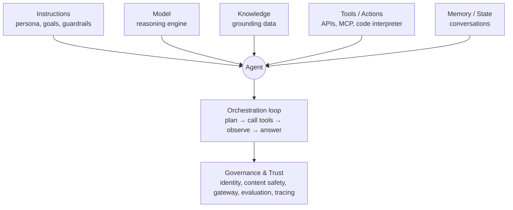

# 1. Agent building blocks

**Next:** [02 — Create the low-code agent](02-build-prompt-agent-foundry-portal.md).

Use the diagram and table below to map each agent building block to the Whisker Works implementation.

| Building block | What it is | In Whisker Works | Where in Foundry |
|---|---|---|---|
| **Model** | The LLM that reasons and decides which tool to call | `gpt-4.1-mini`, later `gpt-5-mini` | Model deployments, agent *Model* field |
| **Instructions** | System prompt: persona, scope, style, guardrails | "You are Whiskers, the concierge…" | Agent *Instructions* |
| **Knowledge** | Grounding data retrieved at runtime (RAG) | Store policies, product guide, cat care | File search, Azure AI Search, Foundry IQ |
| **Tools / Actions** | Things the agent can *do* | Store API (stock, orders) via MCP, code interpreter on sales CSV | Tools: MCP, OpenAPI, Code interpreter, A2A… |
| **Memory / State** | Conversation history, long-term memory | Multi-turn chat in the storefront | Conversations (Responses API) |
| **Orchestration** | The loop that plans, calls tools, observes results, answers | Agent decides between file search and MCP | Agent Service runtime (prompt agents) or your code (hosted agents) |
| **Trust & governance** | Identity, safety, observability, evaluation, gateway | APIM AI gateway on models / tools / agents, tracing, evals | Guardrails, Tracing, Evaluations + APIM |

### Key concepts
1. An agent combines a **model**, **instructions**, **knowledge**, and **tools** in a **loop** with **memory**.
2. Knowledge answers *what do we know*; tools answer *what can we do*.
3. **MCP** standardizes agent-to-tool communication; **A2A** standardizes agent-to-agent communication.
4. APIM provides a shared **control plane** for the model, tool, and agent calls routed through it.

### Prompt agents vs hosted agents (Foundry)
- **Prompt agents** — declarative (model + instructions + tools), versioned, run by Foundry. Used in the low-code and pro-code exercises.
- **Hosted agents** — your own code (Agent Framework, LangGraph…) hosted by Foundry. Demo: [05-build-hosted-agent-framework.md](05-build-hosted-agent-framework.md).

Reference: [What is Foundry Agent Service](https://learn.microsoft.com/azure/foundry/agents/overview)
