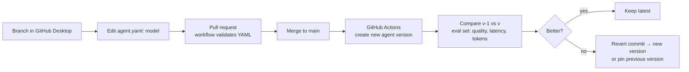

<a id="06--update-an-agent-to-use-a-new-model"></a>

<a id="08--update-an-agent-to-use-a-new-model"></a>

# 8. Change a model safely

**Previous:** [07 — Agent details and evaluation](07-versions-traces-evaluations.md).
**Next:** [09 — Model gateway governance](09-govern-model-calls.md).

Story: *"Null Pointer (CTO) wants to move Whiskers from gpt-4.1-mini to gpt-5-mini — safely."*

In the [notebook walkthrough](whisker-works-demo-runbook.ipynb), Topic 8 continues with the isolated
`whiskers-concierge-pro-live` created in Topic 4. It captures the candidate version and compares it with
the captured baseline on that same agent, without typed version numbers. The commands and GitOps path
below target the original `whiskers-concierge-pro` instead; do not mix versions from those two agents.



<a id="option-1--portal-low-code-quick"></a>

## Option 1 — Portal
1. Foundry > Agents > `whiskers-concierge` > change **Model** to `gpt-5-mini` > **Save** → version 2.
2. In **Versions**, compare the original and new versions using their actual saved version numbers.
3. **Evaluations**: run the same evaluation on both versions (dataset `data/eval/whisker-eval.jsonl`) and compare.

<a id="option-2--code-live-in-the-terminal"></a>

## Option 2 — Terminal
```bash
cd agents/procode
python create_agent.py --model gpt-5-mini     # -> version N+1
python compare_models.py --a 1 --b 2
python chat.py --version 1                    # pin the old version if needed
```
`compare_models.py` prints pass rate (keyword checks), average latency and tokens per version and saves details to `results/`.
For CI/CD, `--output <path>` writes the same result format to a deterministic artifact
path. It still only reports scores; the separate [release gate](../scripts/check-agent-release.py)
applies the [sample policy](../samples/agent-lifecycle/gate-policy.json) and fails the job
when the evidence does not meet it.

Use the actual version numbers shown by creation / Foundry (for example, `--a 2 --b 3`).
The comparison retries rate-limited requests up to five times per query/version, including APIM MCP
429 errors that Foundry wraps in a `400 tool_user_error`. It logs each retry, respects numeric
`Retry-After` / "Try again in ... seconds" hints with a one-second buffer, and otherwise uses
exponential backoff. Override with `--max-retries 8`, or disable with `--max-retries 0`.
Saved results include a `retries` count; latency includes failed attempts and backoff, so throttled
runs are not a clean model-speed comparison. Tokens are those reported by the successful response,
not total billing across failed attempts.

APIM counts actual MCP `tools/call` requests, not user prompts or setup/discovery traffic, with a separate
budget per MCP API and subscription. One prompt can make multiple tool calls. If retries are exhausted,
the script stops with the original error rather than recording a fake answer/pass.
If you previously lowered the MCP policy to `calls="3"` for the governance demo, restore the normal
`calls="30" renewal-period="60"` from [mcp-tools-policy.xml](../apim/policies/mcp-tools-policy.xml)
before comparing models. Stop other demo clients sharing the subscription if they are consuming its budget.
Only use read-only evaluation prompts/tools: retrying an entire agent response could replay a tool
that already completed, so do not use this comparison to place orders.

<a id="option-3--gitops-with-github-desktop--github-actions-recommended-story"></a>

## Option 3 — Optional GitOps with GitHub Desktop and GitHub Actions

To study evaluation-gated releases without running a pipeline, read the
[agent lifecycle samples](../samples/agent-lifecycle/README.md). They are outside the
active workflow directory and require no pipeline run. They separate version creation,
evaluation, approval, and future consumer promotion.

The existing workflow below is a simplified demo: it reports keyword comparisons but
does not fail on quality scores or gate the storefront's latest-version behavior.
Creating a version is not the same as promoting an evaluated release.

### One-time setup
1. Create an Entra app registration / user-assigned identity with a **federated credential** for your repo
   (`repo:<org>/<repo>:ref:refs/heads/main` and `environment:demo`).
2. Grant it **Azure AI User** on the Foundry account.
3. In GitHub repo **Settings**:
   - **Environments** > create `demo`.
   - **Secrets**: `AZURE_CLIENT_ID`, `AZURE_TENANT_ID`, `AZURE_SUBSCRIPTION_ID`.
   - **Variables**: `FOUNDRY_PROJECT_ENDPOINT`, `APIM_GATEWAY_URL`, `MCP_PROJECT_CONNECTION_NAME` (from topic 3).

<a id="live-demo"></a>

### Run the optional workflow

The following steps change the default agent used by the storefront. Use your own repository,
review the workflow and permissions first, and skip these steps if you only want the isolated notebook comparison.

1. GitHub Desktop > **Current branch** > **New branch** `feature/gpt-5-mini`.
2. VS Code: edit [agents/procode/agent.yaml](../agents/procode/agent.yaml) → `model: gpt-5-mini`.
   (Or ask Copilot: *"Switch the pro agent to gpt-5-mini"*.)
3. GitHub Desktop: see the one-line diff → commit `Upgrade Whiskers to gpt-5-mini` → **Publish branch** → **Create Pull Request**.
4. On GitHub: the **validate** job runs on the PR. Review → **Merge**.
5. **Actions** tab: `deploy` job creates the new version and runs `compare_models.py`; download the `agent-comparison` artifact.
6. Foundry portal: new version is visible on `whiskers-concierge-pro`; the storefront chat uses it immediately.
7. Rollback = **Revert** the commit in GitHub Desktop (History > right-click > Revert) → push → new version with the old model.

<a id="talking-points"></a>

### Verify the outcome
- The agent definition is code: reviewed, versioned, auditable.
- Model swap can be a **one-line change**, but safe promotion needs the explicit
  [evaluation gate and approval pattern](../samples/agent-lifecycle/README.md), not just a comparison report.
- APIM layer 1 metrics show token usage per model before/after (docs/09).

## Docs
- [Agent versions / prompt agents](https://learn.microsoft.com/azure/foundry/agents/quickstarts/responses-api)
- [Evaluate your AI agents](https://learn.microsoft.com/azure/foundry/observability/how-to/evaluate-agent)
- [GitHub Actions: OpenID Connect with Azure](https://docs.github.com/actions/security-for-github-actions/security-hardening-your-deployments/configuring-openid-connect-in-azure)
- [GitHub Desktop: branches, commits, PRs](https://docs.github.com/desktop)
