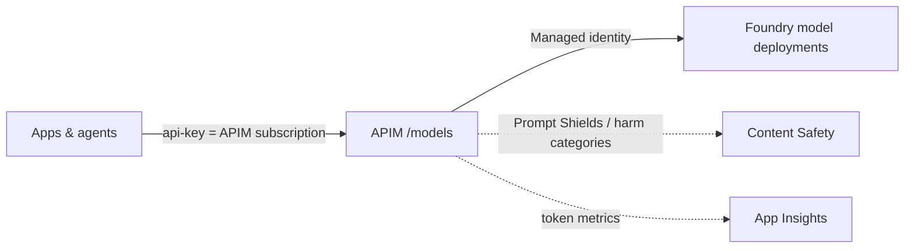

<a id="07--apim-ai-gateway-layer-1-models"></a>

<a id="09--apim-ai-gateway-layer-1-models"></a>

# 9. Govern model calls

**Previous:** [08 — Update the agent model](08-change-model-safely.md).
**Next:** [10 — Content Safety](10-content-safety-gateway.md).



<a id="the-three-governance-layers-intro-slide-for-topics-7-10"></a>

<a id="the-three-governance-layers-intro-slide-for-topics-9-12"></a>

## The three governance layers

| Layer | What is governed | APIM capability | Guide |
|-------|------------------|-----------------|------|
| **1. Models** | LLM calls from apps *and* agents | Token limits/quotas per product, MI auth (no keys to backends), content safety, token metrics, load balancing + circuit breaker, semantic caching | this doc |
| **2. Tools** | Agent → tool calls over **MCP** | REST API → MCP server, proxy existing MCP servers, products/keys/OAuth, rate limits, tool selection, tracing | [11](11-govern-mcp-tools.md) |
| **3. Agents** | Agent → agent calls over **A2A** | A2A agent API, agent card rewrite, rate limits, content safety, OTel `gen_ai.agent.*` attributes | [12](12-govern-agent-to-agent-calls.md) |

All three share **one control plane**: products, subscriptions, policies, analytics, developer portal.

## Configuration (already deployed)
- API **Foundry Models (AI Gateway)**, path `/models`, key header `api-key` (works with the OpenAI/AzureOpenAI SDK as-is).
  In existing mode (docs/00b) the display name is *Whisker - Foundry Models (AI Gateway)* and the path is `APIM_MODELS_PATH`.
- Policy: [apim/policies/models-api-policy.xml](../apim/policies/models-api-policy.xml)
  - `authentication-managed-identity` → no Foundry key ever leaves Azure
  - `llm-content-safety` with `shield-prompt="true"`
  - `llm-token-limit` — **Gold 20,000 TPM**, **Bronze 500 TPM** (per subscription)
  - `llm-emit-token-metric` with dimensions *Subscription*, *Product*, *API*, *Client App*
  - retry on 429 + backend circuit breaker

<a id="demo-script"></a>

## Test model governance

From the repository root, activate `.venv` and confirm that infrastructure setup wrote
`agents/procode/.env`. These requests use the APIM gateway and may incur model charges.

1. **Inspect configuration**: APIM > APIs > *Foundry Models (AI Gateway)* > **Policies** (code view). Inspect each policy.
   Then **Backends** > `whisker-foundry-models` > circuit breaker rule; **Products** > Bronze/Gold.
2. **Normal call (Gold)**
   ```bash
   python scripts/test-gateway.py basic
   ```
   Inspect the `x-consumed-tokens` / `x-remaining-tokens` headers.
3. **Token budget per product (Bronze)**
   ```bash
   python scripts/test-gateway.py throttle
   ```
   Sends at most 10 requests with SDK retries disabled, so the first `429` is visible rather than
   automatically retried after the budget recovers. Each successful call prints actual model usage,
   APIM's `x-consumed-tokens` / `x-remaining-tokens`, and elapsed time. Missing values are shown as
   `missing`, not zero. A successful response can exhaust the budget; `remaining=0` does not mean
   that same response must be a `429`. The limit includes both prompt and completion tokens.

   The test prints the first `429` response and `retry-after`. Use APIM **Trace** to confirm that
   `llm-token-limit`, rather than the model backend, rejected the request. If all 10 calls succeed,
   the script fails explicitly: throttling was not demonstrated. Check the Bronze subscription,
   selected product, inherited policies sharing the counter key, and any policies overwriting
   the headers. Slow responses can let the per-minute budget recover while the test runs.
   Confirm that the Bronze limit is enforced independently of the Gold subscription's budget.
4. **Prompt Shields at the gateway**
   ```bash
   python scripts/test-gateway.py safety
   ```
   → `403` before the prompt reaches the model.
5. **Showback / chargeback**: App Insights > **Metrics** > namespace `whisker-works` > *Total Tokens* split by *Client App* or *Product ID*.
   (Metrics show after a few minutes.) Note the A2A agent appears as `a2a-wellness-agent`: **agents are governed like any other app**.
6. **Test console alternative**: APIs > *Foundry Models* > Test > `POST /*` with URL suffix
   `openai/deployments/gpt-4.1-mini/chat/completions?api-version=2024-10-21` → **Trace** tab shows each policy executing.

## Optional extensions
- **Load balancing** across regions: backend pool + [optional-backend-pool-snippet.xml](../apim/policies/optional-backend-pool-snippet.xml).
- **Semantic caching**: `llm-semantic-cache-lookup/store` + Azure Managed Redis + embeddings deployment.
- **Foundry ↔ APIM**: investigate Foundry's preview AI gateway integration if you want to route
  prompt agents' model calls through APIM. The agents in this kit do not automatically use that path.

## Docs
- [AI gateway capabilities](https://learn.microsoft.com/azure/api-management/genai-gateway-capabilities)
- [llm-token-limit](https://learn.microsoft.com/azure/api-management/llm-token-limit-policy)
- [llm-emit-token-metric](https://learn.microsoft.com/azure/api-management/llm-emit-token-metric-policy)
- [llm-content-safety](https://learn.microsoft.com/azure/api-management/llm-content-safety-policy)
- [Backends, pools and circuit breaker](https://learn.microsoft.com/azure/api-management/backends)
- [AI-Gateway labs (Azure-Samples)](https://github.com/Azure-Samples/AI-Gateway)
