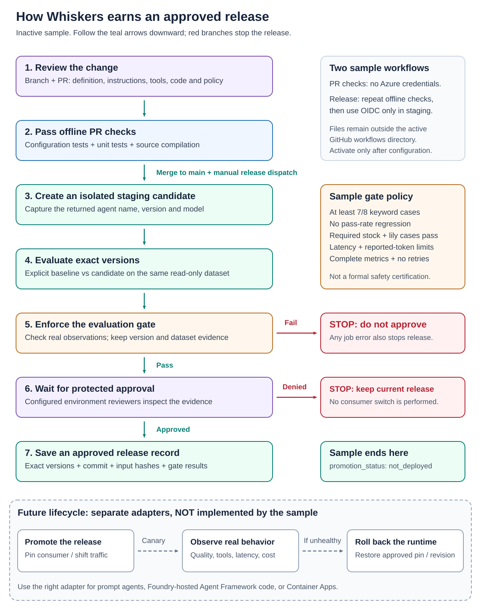

# Whisker Works: agent releases with CI/CD

**Inactive reference samples. Nothing in this directory is an active GitHub workflow.**
Read the pipelines and run the offline gate tests without Azure setup. Activating a pipeline is a
separate, optional exercise: complete the configuration checklist below before copying files into
`.github/workflows/` or dispatching a workflow. Pipeline runs can create agent versions and incur charges.

<a id="the-release-story"></a>

## The release lifecycle



Follow the numbered solid-arrow path downward. Red branches stop the release.
The dashed bottom panel is future rollout/observation/rollback work, not an
implemented deployment stage.

Treat an agent as a release bundle, not just a prompt: definition, instructions, tool
schemas and approval rules, model deployment/version, knowledge snapshot, dataset,
evaluator configuration, dependencies, and application/container code.

| Stage | What happens | Evidence and stop condition |
|---|---|---|
| Author | Null Pointer proposes a model, instruction, tool, or code change on a branch | Reviewed commit; do not edit production agents in the portal |
| PR CI | Validate configuration, compile code, and run offline unit/contract tests | No Azure login, model calls, deployment credentials, or write tools |
| Candidate | Create a version under the isolated staging agent name | Capture the API-returned name/version/model; never infer `version - 1` |
| Evaluate | Invoke the exact candidate and explicit baseline on the same dataset | Complete result rows, keyword scores, latency, reported tokens, retries |
| Gate | Apply the reviewed policy to the actual observations | Missing evidence, evaluation errors, regressions, and failed checks stop release |
| Approve | A protected environment waits for a reviewer to inspect the evidence | Approval recorded in GitHub; authors should not approve their own release |
| Promote | A runtime-specific rollout switches a consumer to the approved version | Separate operation; **not implemented or claimed by this sample** |
| Observe | Watch real task success, safety, tool errors, latency, and cost | Canary stop/rollback criteria; monitor the released identity, not "latest" |
| Roll back | Restore the previous approved consumer pin or image/revision | No need to delete versions or hope a new version recreates the old behavior |

<a id="files-to-show"></a>

### Files to inspect

1. [PR checks](pr-checks.yml): trusted offline tests only; no OIDC permission.
2. [Release workflow](release-agent.yml): manual dispatch, exact baseline, isolated
   candidate, evaluation, fail-closed gate, evidence artifact, protected review.
3. [Gate policy](gate-policy.json): measurable, reviewable thresholds.
4. [Gate implementation](../../scripts/check-agent-release.py): rejects missing or
   malformed observations and returns a nonzero exit code when a gate fails.
5. [Comparison runner](../../agents/procode/compare_models.py): invokes pinned
   versions and can write to a deterministic `--output` path.

Read the YAML from top to bottom without running it. Note that
the release record ends with `"promotion_status": "not_deployed"`. It is evidence for
a future rollout adapter, not a production deployment disguised as a successful job.

## Evaluation: what actually blocks this sample

The eight-case [dataset](../../data/eval/whisker-eval.jsonl) is deliberately small.
The [policy](gate-policy.json) requires:

- At least **87.5% keyword pass rate**, meaning **7 of 8** cases, not a rounded display value.
- No aggregate pass-rate regression against the supplied baseline.
- Both the lily-toxicity and live stock keyword cases must pass, even if the overall score passes.
- Candidate average latency at most 60 seconds and reported token total at most 20,000.
- No retries in either version's results, so throttled runs do not masquerade as clean comparisons.
- Every dataset case present once, in order, for both exact versions; finite metrics,
  actual token usage, valid boolean scores, and scores consistent with the returned answer.

The gate saves exact agent identity, source commit, both versions, metrics, failure
reasons, and SHA-256 hashes of dataset, policy, candidate identity, and comparison files.
The approved record points back to the GitHub run. Baseline selection is explicit
because previous numeric version does not necessarily mean previous approved release.

**These are demo thresholds, not production quality or safety guarantees.**
Substring checks cannot prove grounding, useful answers, correct tool execution,
prompt-injection resistance, or safe behavior. In particular, the lily check only
checks the word `toxic`; it is not a safety classifier. A minimum-sized, representative
holdout set with repeated runs is needed before setting meaningful release thresholds.

For production, add real Foundry evaluation runs for task adherence, relevance,
groundedness with supplied context, and tool-call accuracy with tool/reference inputs.
Evaluate refusal/safety and approval-denial scenarios separately; verify actual tool
execution and that denied writes have **zero side effects**. Select supported
evaluators and their schemas when wiring that adapter. Require completed evaluator
runs and complete per-case scores; Partial, N/A, skipped, timeout, 401, and 429 are
**not** successful evaluations. Calibrate judge models with human review, pin their
configuration, and keep a holdout set separate from prompt optimization.

The sample's token total covers successful responses, **not all billed work**.
Retries, tools, hosted compute, and judge inference may add cost. The policy is not
a hard spending cap. Use gateway quotas, bounded retries, job timeouts, concurrency,
cost alerts, and an evaluation budget in addition to the metric checks.

## Promotion and rollback across the three agent styles

| Runtime | Immutable thing to evaluate | Future promotion adapter | Rollback |
|---|---|---|---|
| Managed prompt agent | Returned Foundry name/version, model deployment, tool and knowledge references | Pin a consumer's `agent_reference` to the approved version in that project | Restore the previous approved name/version |
| Agent Framework hosted by Foundry | Source/dependency lock, image digest or remote-build artifact, deployed hosted name/version, runtime identity | Build once, deploy/start the candidate, wait for readiness, evaluate its actual endpoint, then switch the pinned consumer | Restore the previous tested hosted version and consumer pin; verify readiness |
| Application on Container Apps | Container image digest, ACA revision, configuration/identity, gateway route | Deploy a no-production-traffic candidate revision, evaluate through the real APIM path, then shift traffic gradually | Restore previous revision/traffic weights and route; verify health and errors |

The latter two rows are lifecycle designs, **not additional runnable workflows**.
Use the [hosted-agent setup](../../docs/05-build-hosted-agent-framework.md) and
[Container Apps setup](../../docs/06-optional-container-apps-agent.md) as the runtime
adapters when implementing those pipelines later. Do not copy a prompt-agent
`create_version` step into a hosted/ACA pipeline and call it a deployment.

The current [storefront](../../src/catstore-api/main.py) sends an agent name without
a version, so it follows latest. The existing [update workflow](../../.github/workflows/update-agent.yml)
creates a version under the original agent name and reports a comparison; it does
**not** enforce these release gates. Do not mistake it for production-safe promotion.
The new sample uses **`whiskers-concierge-pro-release` in a separate staging project**,
not the storefront agent. It deliberately does not modify the storefront.

A future pinned consumer request would contain:

```python
extra_body={
    "agent_reference": {
        "name": approved_release["agent"],
        "version": approved_release["candidate_version"],
        "type": "agent_reference",
    }
}
```

A version number is scoped to its agent/project. To release to another project,
recreate/deploy the same reviewed bundle there, capture the **new** returned identity,
and verify it before switching traffic. Never assume a staging version number exists
in production. Reverting Git creates new deployment history; it is not an immediate
rollback of a running consumer.

<a id="pipeline-practices-to-call-out"></a>

## Pipeline practices to verify

- **Isolation:** separate dev/staging/prod projects, read-only test data, and least-privilege
  runtime and pipeline identities. Never run untrusted PR code with Azure credentials;
  do not use `pull_request_target` to execute PR code.
- **OIDC:** short-lived Azure federation scoped to the exact repository and protected
  GitHub environment. `id-token: write` appears only in the candidate job.
  `DefaultAzureCredential` uses the logged-in CLI identity; no Azure keys are committed.
- **Approval:** protected main branch, CODEOWNERS for definitions/policies/datasets,
  required PR checks, required environment reviewers, disallowed self-review, and
  deployment branch restrictions. An `environment:` line alone does not create reviewers.
- **Immutable inputs:** actions are pinned to commit SHAs; check out the workflow's
  source commit, lock application/SDK dependencies, build images once and use digests.
  The existing requirements use lower bounds; **resolve and commit tested locks before
  production use**. Review dependency/action updates rather than blindly floating tags.
- **Knowledge and models:** snapshot/version the vector store and input files, model
  deployment/version, tool schemas, approvals, and APIM configuration. The existing
  `create_agent.py` reuses a named vector store; it does **not** reindex changed files.
  A Git commit alone therefore does not snapshot external knowledge or model state.
  Create an immutable knowledge snapshot before using this pattern for knowledge releases.
- **Fail closed:** no `continue-on-error`, `|| true`, fabricated scores, skipped evaluation
  gates, or automatic fallback to latest. A failed gate leaves the candidate unpromoted.
- **Evidence:** retain dataset/evaluator hashes, response IDs where available, model/runtime
  identity, and gate outcomes; redact credentials and restrict artifact access/retention.
  This comparison file contains prompts and answers. Use synthetic data, not customer data.
- **Concurrency and recovery:** serialize candidate releases, cancel superseded PR checks,
  bound retries and runtime, retain previous approved releases, and test rollback.
  A rerun may create a new candidate version; always capture/evaluate that returned version.
- **Observe after release:** compare canary against baseline, track tool authorization errors,
  denied writes, response quality and latency, and audit APIM and Foundry traces separately.
  Promotion is a start of observation, not proof of permanent quality.

## Configuration checklist for a future run

These steps are optional and are not needed to read the samples or run offline tests.
Complete them only when you intentionally want to activate the staging workflow.

1. Review the policy, dependencies, representative read-only dataset, branch protection,
   knowledge snapshots, and runtime identity/RBAC. The pipeline identity needs permission
   to create agent versions, upload files, read the project connection, and invoke models;
   judge evaluators need their own inference permissions. Grant only the verified scope.
2. Create protected environments `agent-staging` and `agent-release-approval`. Configure
   reviewers and main-only deployment restrictions **in GitHub settings**, including
   protection against self-approval where supported.
3. In `agent-staging`, configure variables `AZURE_CLIENT_ID`, `AZURE_TENANT_ID`,
   `AZURE_SUBSCRIPTION_ID`, `FOUNDRY_PROJECT_ENDPOINT`, `APIM_GATEWAY_URL`, and
   `MCP_PROJECT_CONNECTION_NAME`. Scope the federated subject exactly to
   `repo:ORG/REPO:environment:agent-staging`. Keep the APIM subscription key in the
   staging Foundry project connection; use read-only Store MCP tools.
4. Prepare an initial approved baseline under `whiskers-concierge-pro-release` in the
   **staging project** and record its actual version. First release is a reviewed bootstrap;
   the sample never invents or silently skips a baseline.
5. Only when ready to activate, copy the samples to
   `.github/workflows/whisker-agent-pr-checks.yml` and
   `.github/workflows/whisker-agent-release.yml`. Review them again before merging.
   The release workflow has only manual dispatch and only runs from main.
6. A future dispatch makes billable model/tool calls and creates a staging agent version.
   Review its evidence, then separately implement/test the runtime-specific promotion
   adapter. Until that exists, even an approved record explicitly remains **not deployed**.

## References

- [Foundry hosted-agent CI/CD](https://learn.microsoft.com/azure/foundry/agents/quickstarts/set-up-cicd-hosted-agent?pivots=azd)
- [Foundry agent evaluation](https://learn.microsoft.com/azure/foundry/observability/how-to/evaluate-agent)
- [GitHub OIDC with Azure](https://docs.github.com/actions/security-for-github-actions/security-hardening-your-deployments/configuring-openid-connect-in-azure)
- [GitHub deployment environments](https://docs.github.com/actions/deployment/targeting-different-environments/managing-environments-for-deployment)
